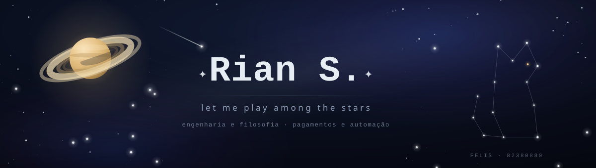
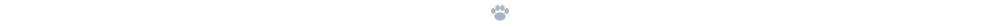
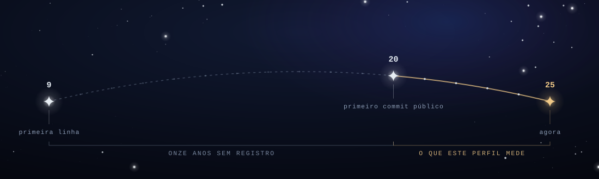
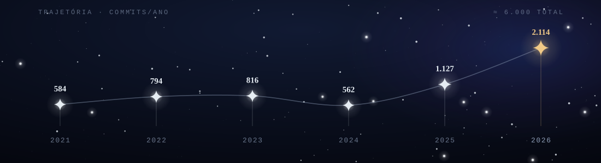

  
   
  &nbsp;

   
  <i>É preciso ter ainda caos dentro de si para poder dar à luz uma estrela dançarina.</i>
    
  N I E T Z S C H E &nbsp;·&nbsp; <i>Assim falou Zaratustra</i>, Prólogo

   
  

## ☾ &nbsp;Matéria escura

**Dezesseis anos escrevendo código. Cinco deles aparecem aqui.**

  
   
  &nbsp;

A matéria escura não é a exceção do universo. É a maior parte dele. Deduziram
sua existência porque as galáxias giravam rápido demais para a massa que se
podia ver. Havia mais ali do que se deixava observar, e era justamente o
não-observado que segurava o resto no lugar.

Todo perfil mede luz. O começo não emitiu nenhuma. Comecei aos nove
anos, e os onze que vieram depois, os que ensinaram tudo, não deixaram commit,
estrela nem registro. O que se aprende antes de existir publicamente não pode
ser mostrado depois. Só pode ser usado.

**250 repositórios. 200 deles são privados.**

Com o presente acontece o mesmo. Gateways de pagamento, sistemas que sustentam
empresas inteiras, trabalho que passou por campanhas políticas e por nomes que
você reconheceria se eu escrevesse. Nada disso emite. Tudo isso segura.

Quem constrói o que importa constrói, em boa parte, fora do alcance dos olhos.
Isso não é privação. É a forma que o trabalho assume quando passa a ter peso.

   
  

## ✦ &nbsp;Devir

  
   
  &nbsp;

Nenhuma dessas curvas foi planejada. Uma força que cresce não obedece a projeto:
ela encontra mais do que sabia querer, e então passa a querer mais. Cada ano
aqui é o ano anterior superado. Não corrigido: superado. São coisas diferentes.
Corrigir supõe que havia erro. Superar supõe apenas que havia menos.

Há um ano mais baixo no meio do caminho. Ele não é uma falha na linha. Ele é a
linha. Zaratustra precisa descer da montanha antes de ter o que dizer, e desce
sabendo que desce. Toda subida que vale alguma coisa começa por um declínio que
ninguém escolheu e que, depois, ninguém trocaria.

Uma das primeiras coisas que construí continua de pé. Nasceu pequena, feita por
alguém cedo demais para saber o que estava fazendo, e nunca parou de crescer:
trocou de linguagem, de arquitetura, de finalidade, e permaneceu a mesma coisa.
Chama-se Astrid. É a prova mais limpa que tenho de que uma obra não se termina.
Ela se continua, e ao continuar continua também quem a escreve.

   
  

## ✧ &nbsp;Consequência

Ferramenta se aprende em semanas. Domínio custa anos, e é a única coisa que não
se transfere lendo documentação. O que vem abaixo não é o que eu uso: é aquilo
por que eu respondo.

  
   
  &nbsp;

Ferramenta ainda importa, mas importa depois. Escolher linguagem é escolher onde
a dificuldade vai morar: Rust exige tudo antes de deixar compilar, TypeScript
cobra no instante em que alguém lê. Toda decisão técnica é uma decisão sobre
quando pagar, e quem constrói para durar paga cedo, antes que a realidade cobre
com juros.

<b>Camadas</b> · o que ficou de cada período

 

**O começo.** Uma linguagem que quase ninguém mais escreve, num domínio que já
fechou as portas. Ficou a compreensão de que código não é texto: é um lugar que
outras pessoas habitam ao mesmo tempo que você.

**A integração.** Anos fazendo sistemas conversarem com sistemas. Ficou a
certeza de que nada existe isolado, e de que a fronteira entre duas coisas é
sempre onde mora o problema verdadeiro.

**A superfície.** Interface, entrega, velocidade. Ficou o respeito por quem usa.
A elegância que ninguém alcança não chegou a ser elegância.

**O rigor.** Dinheiro. Transações que não podem desaparecer. Ficou o gosto por
sistemas em que o erro tem nome, hora e consequência, e por isso pode ser
enfrentado de frente.

   
  

## ◐ &nbsp;Duas disciplinas

Estudo filosofia e ciência da computação. Costumam me perguntar como concilio as
duas, o que pressupõe que sejam duas.

Não são. Ambas consistem em erguer sistemas que não podem se contradizer, e em
descobrir o que acontece quando se contradizem assim mesmo. Um argumento mal
formado e um sistema mal formado quebram pelo mesmo motivo: alguém aceitou uma
premissa sem verificar a que ela obrigava.

A diferença está no prazo do vencimento. Em filosofia, uma premissa ruim
atravessa séculos antes de cobrar. Em produção, ela cobra na madrugada de
domingo, e essa pressa é uma forma de honestidade que a filosofia inveja.

   
  

## ⋆ &nbsp;Amor fati

A maior parte do que escrevi já não existe. Foi apagada, reescrita, ou roda
agora em algum lugar sem precisar de mim para continuar. Isso não pede luto: é a
prova de que houve movimento, e movimento é a única evidência de força que não
se pode falsificar.

Não procuro emprego. Isso não é recusa ao trabalho, é o contrário exato. É a
recusa de que outra pessoa decida qual trabalho. Liberdade, aqui, nunca
significou fazer menos: significa que a única lei que rege o que eu construo é a
que eu mesmo assino.

   
  <i>Torna-te o que tu és.</i>
    

Nietzsche propôs o teste mais duro que existe: se tudo isto tivesse de se
repetir exatamente igual, infinitas vezes, sem nada acrescentado e nada
poupado, você diria sim?

Eu diria.

Nada do que foi feito com inteireza precisa sobreviver para ter valido. A luz
que chega à noite partiu de fontes que já mudaram de estado há muito tempo.
Continua sendo luz. Continua chegando. Continua bastando.

   
  ⋆｡°✩ &nbsp; <i>órbita é queda que nunca acerta o chão</i> &nbsp; ✩°｡⋆

